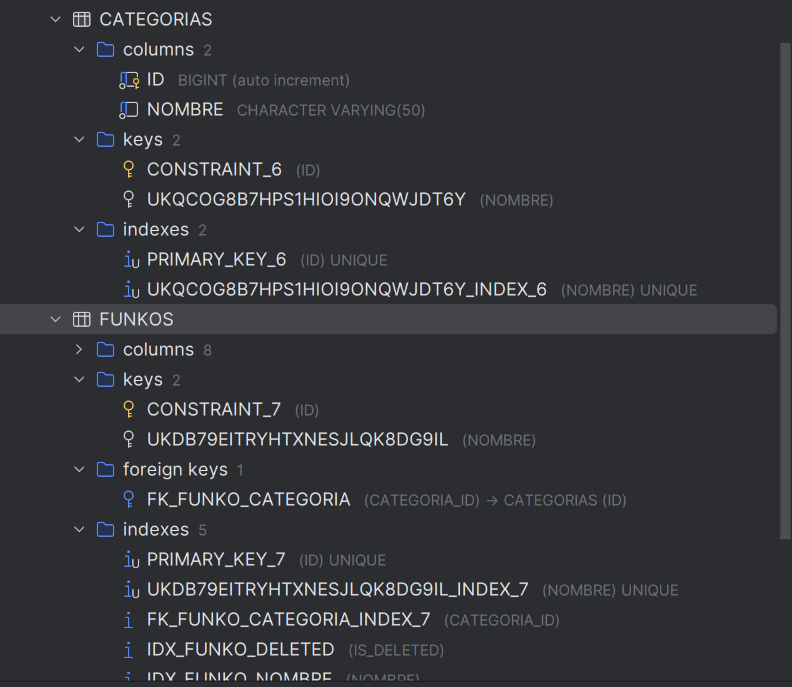

- Relación 1 a m actual



- En caso de usar validation en Entidad:

```java

package es.iesx.funkos.categorias.models;

import es.iesx.funkos.funkos.models.Funko;
import jakarta.persistence.*;
import jakarta.validation.constraints.NotBlank;
import jakarta.validation.constraints.Size;
import lombok.AccessLevel;
import lombok.Getter;
import lombok.NoArgsConstructor;

import java.util.ArrayList;
import java.util.Collections;
import java.util.List;

@Entity
@Table(name = "categorias")
@Getter
@NoArgsConstructor(access = AccessLevel.PROTECTED)
public class Categoria {

    @Id
    @GeneratedValue(strategy = GenerationType.IDENTITY)
    private Long id;

    @NotBlank(message = "El nombre es obligatorio")
    @Size(max = 50, message = "El nombre no puede superar los 50 caracteres")
    @Column(nullable = false, unique = true, length = 50)
    private String nombre;

    @OneToMany(mappedBy = "categoria")
    private List<Funko> funkos = new ArrayList<>();

    public Categoria(String nombre) {
        this.nombre = nombre;
    }

    public void cambiarNombre(String nombre) {
        this.nombre = nombre;
    }

    public List<Funko> getFunkos() {
        return Collections.unmodifiableList(funkos);
    }
}


package es.iesx.funkos.funkos.models;

import es.iesx.funkos.categorias.models.Categoria;
import jakarta.persistence.*;
        import jakarta.validation.constraints.*;
        import lombok.AccessLevel;
import lombok.Getter;
import lombok.NoArgsConstructor;

import java.math.BigDecimal;
import java.time.LocalDateTime;

@Entity
@Table(name = "funkos")
@Getter
@NoArgsConstructor(access = AccessLevel.PROTECTED)
public class Funko {

    @Id
    @GeneratedValue(strategy = GenerationType.IDENTITY)
    private Long id;

    @NotBlank(message = "El nombre es obligatorio")
    @Size(max = 100, message = "El nombre no puede superar los 100 caracteres")
    @Column(nullable = false, unique = true, length = 100)
    private String nombre;

    @NotNull(message = "El precio es obligatorio")
    @DecimalMin(value = "0.00", inclusive = false,
            message = "El precio debe ser mayor que cero")
    @Digits(integer = 8, fraction = 2,
            message = "El precio admite hasta 8 enteros y 2 decimales")
    @Column(nullable = false, precision = 10, scale = 2)
    private BigDecimal precio;

    @NotNull(message = "La cantidad es obligatoria")
    @PositiveOrZero(message = "La cantidad no puede ser negativa")
    @Column(nullable = false)
    private Integer cantidad;

    @NotNull(message = "La categoría es obligatoria")
    @ManyToOne(fetch = FetchType.LAZY, optional = false)
    @JoinColumn(
            name = "categoria_id",
            nullable = false,
            foreignKey = @ForeignKey(name = "fk_funko_categoria")
    )
    private Categoria categoria;

    @Column(name = "is_deleted", nullable = false)
    private boolean deleted = false;

    @Column(name = "created_at", updatable = false)
    private LocalDateTime createdAt;

    @Column(name = "updated_at")
    private LocalDateTime updatedAt;

    public Funko(String nombre, BigDecimal precio,
                 Integer cantidad, Categoria categoria) {
        this.nombre = nombre;
        this.precio = precio;
        this.cantidad = cantidad;
        this.categoria = categoria;
    }

    public void cambiarNombre(String nombre) {
        this.nombre = nombre;
    }

    public void cambiarPrecio(BigDecimal precio) {
        this.precio = precio;
    }

    public void cambiarCantidad(Integer cantidad) {
        this.cantidad = cantidad;
    }

    public void cambiarCategoria(Categoria categoria) {
        this.categoria = categoria;
    }

    public void eliminar() {
        this.deleted = true;
    }

    public void restaurar() {
        this.deleted = false;
    }

    @PrePersist
    void alCrear() {
        this.createdAt = LocalDateTime.now();
        this.updatedAt = this.createdAt;
    }

    @PreUpdate
    void alActualizar() {
        this.updatedAt = LocalDateTime.now();
    }
}


```